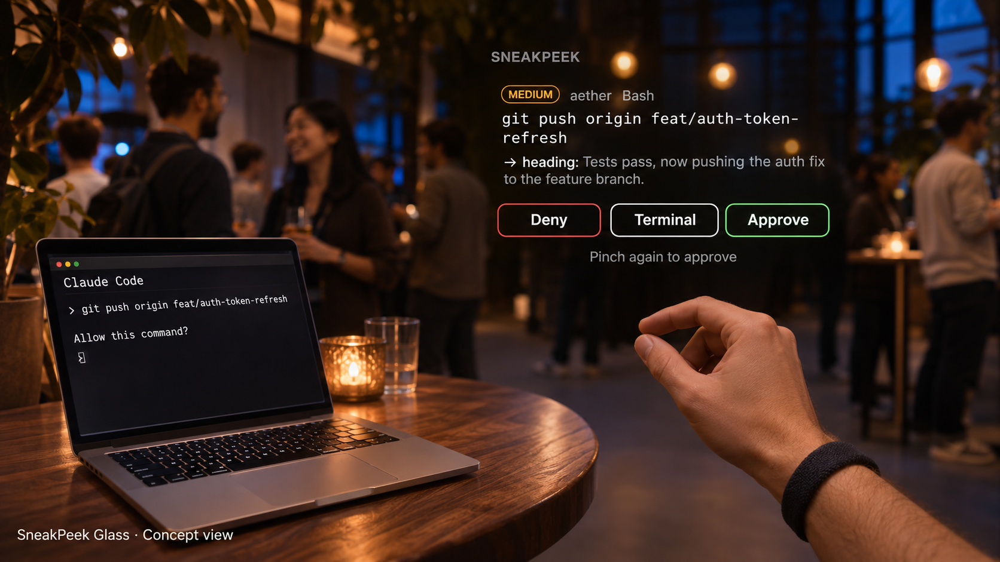

# SneakPeek Glass

Review a coding agent’s permission request from a 600 × 600 display. See which project is waiting, deny the action, send it back to the host, or approve a narrowly scoped read. This prototype grew out of a conversation at an AI event in Helsinki.



*Concept view.* The original sketch shows a Git push. The reviewed build requires terminal approval for every shell command, including that push.

## Try it on a Mac

Use Node 18 or newer. The relay, hook, and unit tests use Node’s standard library. Run these commands in a shell in the checkout. Keep that shell open for your agent.

```sh
npm test
export SNEAKPEEK_TOKEN="$(openssl rand -hex 24)"
pair_code="$(openssl rand -hex 24)"
printf 'Pairing suffix (valid for 10 minutes): #pair=%s\n' "$pair_code"
SNEAKPEEK_PAIR_CODE="$pair_code" node relay/relay.mjs &
unset pair_code
```

For a desktop preview, append the printed suffix to `http://127.0.0.1:8787/` and open the resulting address in a browser. For Meta Ray-Ban Display, route a trusted HTTPS tunnel to the same loopback port. For example, run `cloudflared tunnel --url http://127.0.0.1:8787` in another terminal. Append the suffix to its HTTPS address and use **Add a Web App** in the Meta AI app’s developer settings. The code pairs one browser per relay start, so choose the glasses or the desktop for each run. [Meta’s setup guidance](https://developers.meta.com/wearables/faq/)

Merge the Claude example in [hook/settings.example.json](hook/settings.example.json) into your Claude Code settings. Point its command at the absolute path to the hook in your trusted checkout. Start an interactive Claude session from the shell with `SNEAKPEEK_TOKEN`, then trigger a permission request. An already permitted tool call can complete without a card. [Claude Code hooks](https://code.claude.com/docs/en/hooks#permissionrequest)

To exercise the entire flow without sending a model prompt, run this from the checkout while the paired browser is open. Select Approve twice and the command prints the one-time hook decision.

```sh
node -e 'console.log(JSON.stringify({hook_event_name:"PermissionRequest", session_id:"demo", cwd:process.cwd(), tool_name:"Read", tool_input:{file_path:process.cwd()+"/README.md"}}))' | node hook/sneakpeek-hook.mjs
```

## What can you approve?

The display starts with **Terminal** focused. Use left or right to choose an action. Two separate activations within three seconds approve the current request. Moving focus cancels confirmation.

The Claude adapter permits a file-name search in the working directory using one of six exact patterns (`*.md`, `*.js`, `*.mjs`, `*.ts`, `*.py`, `*.json`) or a plain Read of a regular top-level `README.md`, `CHANGELOG.md`, or `LICENSE`. Additional arguments or a symlinked document require terminal review. Both the hook and relay check eligibility. A read can disclose a document’s contents to the agent. Use a trusted workspace and a trusted hook installation.

All other tools, including writes, shell commands and MCP calls, have Deny and Terminal actions. Long previews show both ends and an omission count. The card identifies the project and session. The hook discards transcript text and write contents.

## Connection and privacy

The hook talks to a relay on the same Mac. A submit token can queue requests. The paired browser holds a separate decision token in same-origin local storage. Reloading the page restores the pairing. Restarting the relay revokes the browser token, drops pending requests, and requires a fresh pairing code. The HTTPS tunnel provider can see request previews and authenticated traffic. Treat the pairing link as private.

The browser polls every 1.5 seconds while visible. With no recent viewer, the relay immediately defers a new request. If the viewer disconnects, outstanding requests defer after about 10–11 seconds. Otherwise the relay waits up to 110 seconds, the hook waits 115 seconds, and the host hook configuration allows 120. An empty hook response returns control to the host’s normal policy. A noninteractive host may deny the request.

The relay writes decision metadata as JSON lines to stdout. Each entry records time, request ID, project, tool, session tag, and decision source. For a local record, redirect the relay’s stdout to a private log. Anyone with the paired browser credential can act as that viewer. The queue holds four requests per session and 32 overall.

## Verification

Run `npm test` for the relay and hook process tests. With Chrome installed, run `npm ci` and `npm run test:browser` on Node 20+ for the 600 × 600 interaction test. GitHub Actions runs both suites.

The app targets the display model. Physical gesture timing, phone tethering, pairing-link handling, readability in daylight, and battery use still need an on-device trial. Keep the app in the foreground during a trial. [Meta Web Apps](https://developers.meta.com/wearables/web-apps/)
